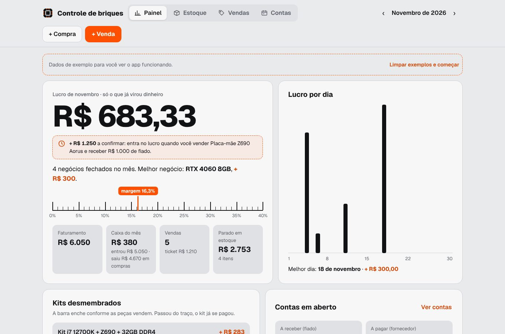

# Controle de briques

App de controle para quem revende peças de computador ("briques"): compra, venda, troca e desmonte de kits, mostrando o lucro de verdade de cada negócio. Fiz para um revendedor de peças.

## O problema

Nessa revenda, quase nenhum negócio é simples. Um kit entra como parte do pagamento de outro (o "rolo"), depois é desmontado e vendido peça por peça, e às vezes a venda fica no fiado. Sem um sistema, fica difícil saber quanto cada negócio deu de lucro e quanto dinheiro está parado no estoque.

## O que o app faz

- **Lucro que já virou dinheiro:** o lucro do mês conta só o que foi recebido. O que ainda depende de fiado ou de peça vendida aparece à parte, como "a confirmar".
- **Rolos:** um item recebido como parte do pagamento entra no estoque com o custo certo e fica ligado à venda de origem.
- **Kits desmembrados:** o custo do kit é rateado entre as peças, e uma barra mostra quanto do kit já se pagou conforme as peças vendem.
- **Contas em aberto:** fiado a receber e parcelas a pagar a fornecedores, com vencimento e pagamentos parciais.
- **Régua de margem**, lucro por dia, lucro por tipo de peça e o que está parado há mais tempo no estoque.
- Abas de estoque, vendas e contas, navegação por mês e layout próprio para celular.

## Como funciona

HTML, CSS e JavaScript puros num arquivo só, sem framework e sem build. Os dados ficam no navegador (`localStorage`). Quando o app roda dentro do Claude, ele usa o armazenamento do usuário para sincronizar entre aparelhos.

## Rodar

Abra o `index.html` no navegador ou publique a pasta no GitHub Pages ou no Netlify.

> Os valores dos prints são os dados de exemplo do próprio app, não dados do cliente.
